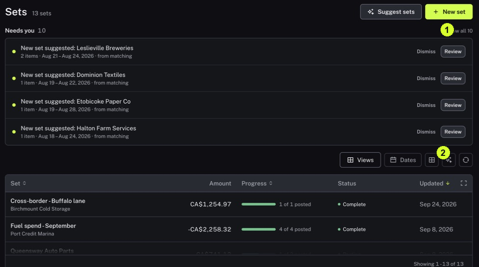

A Match explains one event; a Set explains why several events belong together. Checking the group's membership helps you view related work without losing the evidence for each event.

<Tip>
**Example:** A project has several supplier payments. A Set can collect those Matches so you can review the project's members together.
</Tip>

<Info>
**Before you start:** Know the project or other context you are looking for. A Set's membership review and the financial review of each Match are different tasks.
</Info>

<Frame caption="Needs you contains membership suggestions; the list below shows your existing Sets.">
  
</Frame>

## Step by step

1. Click Records in the sidebar, then click Sets in the view switch beside Records and Matches. The Sets switch appears once your organization has at least one Set.
2. Find the Set in the list and click it. Read its name to confirm the business context. Read Net amount and the count of members posted to the ledger as separate measures.
3. Use All, Needs attention, Matched, Open or History to choose which members to inspect.
4. Click Open beside a member to review its Match, or Resolve if it has an issue. Check that it belongs in the Set and that its own evidence is sound.
5. For a suggestion, return to the Sets list and click Review under Needs you. Read Why these belong together, untick any item that does not belong, then click Create set or Add items. Use Dismiss suggestion if the grouping is wrong.
6. Before interpreting a total, check which Matches are included and what the amount measures. Do not automatically add totals from overlapping Sets.

<Check>
**Expected result:** You understand the Set's purpose and can explain why the inspected Matches belong in it.
</Check>

<Warning>
**If you get stuck:** If a Set looks complete but still needs attention, check membership suggestions as well as member Match warnings. Posted members do not settle every membership question.
</Warning>

## Other things Needs you can show

- **A Match in more than one Set:** click Choose a set to open the Match and pick its home. Confirming one Set releases the Match from the others.
- **Open items going stale:** click Open set to see the items still waiting for a Match.

<Note>
Click Suggest sets to have Nini propose new groupings, or New set to create one yourself. Right-click a Set in the list to export it as CSV, rename, archive or delete it. Do not treat displayed Set totals as a simple sum of cash movements.
</Note>
